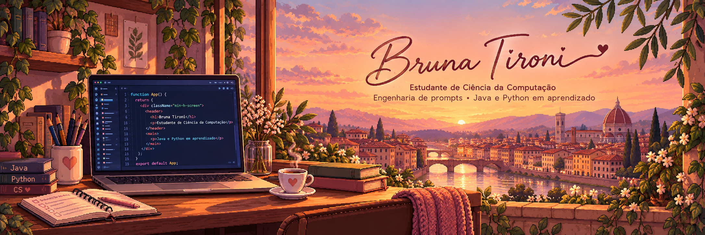

<!-- Perfil: bru-ddecor | Português BR + English -->
<!-- Banner: Florença ao pôr do sol · detalhes em marsala, marinho e dourado -->

  

  <strong>Estudante de Ciência da Computação | IA aplicada e automação</strong> 
  Engenharia de prompts · Desenvolvimento assistido por IA · Java e Python em aprendizado

  

  <a href="#sobre-mim">Sobre mim</a> ·
  <a href="#tecnologias">Tecnologias</a> ·
  <a href="#projetos-selecionados">Projetos</a> ·
  <a href="#contato">Contato</a> ·
  <a href="#english">English ↓</a>

<strong id= "sobre-mim">Sobre mim</strong> 
Estou construindo minha trajetória em tecnologia com foco em IA aplicada e automação, conectando minha sensibilidade ao design à criação de soluções para necessidades reais. Meu interesse por UX/UI orienta a forma como penso interfaces: clareza, hierarquia visual e cuidado com a experiência de quem usa. Trago do atendimento ao cliente a escuta e a comunicação para compreender problemas e avaliar soluções. Tenho facilidade para aprender ferramentas e gosto de investigar, experimentar e refinar o que construo. Na LumaLabVitrine, conduzi a criação de uma vitrine para os produtos da minha marca com apoio do Codex e integração com Supabase, definindo a proposta e refinando a implementação. Busco minha primeira oportunidade profissional em tecnologia para desenvolver essa base, aprender com uma equipe e contribuir com projetos de IA e automação.
- Formação:  cursando Ciência da Computação na UNIP e Técnico em Desenvolvimento de Sistemas na ETEC.
- Prática atual:  desenvolvimento assistido por IA, engenharia de prompts e integração de interfaces com dados.
- Próximos passos:  aprofundar Java, Python e os fundamentos necessários para construir automações e aplicações com IA.
- Além do código:  amo design, culturas e idiomas.
Gosto de entender como algo funciona e de cuidar de como isso chega às pessoas.

<strong id= "tecnologias">Tecnologias utilizadas em projetos e estudos</strong> 

  

<strong>Interfaces, ferramentas e desenvolvimento de aplicativos</strong> 

  

<strong>Em aprendizado</strong> 

  

As tecnologias representam meu contato em projetos e estudos, sem equivalência de domínio entre elas.  
<strong id= "projetos-selecionados">Projetos selecionados</strong> 
Uma seleção do que já está no código. As descrições apresentam o estágio real de cada projeto, incluindo uma vitrine funcional para minha marca.  
<table>
  <tr>
    <td width="50%" valign="top">
      <h3>01 · Malagon</h3>
      
<strong>Planejamento de intercâmbio</strong>

      
Interface com busca de universidades e filtros por país, além de um painel de estimativas financeiras. O servidor inclui rotas para listar universidades e consultar por identificador, com dados definidos no código.

      
<code>HTML</code> <code>CSS</code> <code>JavaScript</code> <code>Node.js</code> <code>Express</code>

      
TCC em desenvolvimento · sem apresentar integrações futuras como concluídas.

      <a href="https://github.com/bru-ddecor/Malagon"><strong>Explorar o código ↗</strong></a>
    </td>
    <td width="50%" valign="top">
      <h3>02 · LumaLabVitrine</h3>
      
<strong>Vitrine de produtos reais · desenvolvimento assistido por IA</strong>

      
Vitrine criada para apresentar os broches da minha marca, disponíveis à pronta entrega, com fotografias reais aprimoradas com IA e fiéis aos produtos. Conduzi o projeto com apoio do Codex, definindo ideias e requisitos, revisando resultados e refinando a implementação até atender às necessidades da vitrine. O projeto inclui banco de dados com Supabase e faz parte dos meus estudos de engenharia de prompts e agentes de IA.

      
<code>React</code> <code>JavaScript</code> <code>CSS</code> <code>Supabase</code> <code>Codex</code>

      
Vitrine funcional para uma necessidade real da minha marca.

      <a href="https://github.com/bru-ddecor/LumaLabVitrine"><strong>Explorar o código ↗</strong></a>
    </td>
  </tr>
  <tr>
    <td width="50%" valign="top">
      <h3>03 · ItalyGuide</h3>
      
<strong>Exploração visual com Flutter</strong>

      
Interface de guia turístico com categorias e destinos, alternância entre temas claro e escuro e gerenciamento do tema com Provider. A tela inicial adapta a grade à largura disponível e inclui animações nos cartões.

      
<code>Flutter</code> <code>Dart</code> <code>Provider</code>

      
Projeto acadêmico · conteúdo de demonstração e navegação em evolução.

      <a href="https://github.com/bru-ddecor/ItalyGuide"><strong>Explorar o código ↗</strong></a>
    </td>
    <td width="50%" valign="top">
      <h3>O que conecta esses projetos</h3>
      
Meu interesse em transformar informação em interfaces compreensíveis, explorar diferentes ferramentas e aproximar desenvolvimento e design.

      
Este perfil acompanha uma formação em andamento. Prefiro mostrar o estágio real de cada projeto e evoluir a partir dele.

      <a href="https://github.com/bru-ddecor?tab=repositories"><strong>Ver todos os repositórios ↗</strong></a>
    </td>
  </tr>
</table>

Cursos e aprendizado contínuo
Uma coleção em construção: cursos que complementam minha formação e acompanham meus próximos passos em tecnologia.

[**Explorar a pasta de certificados ↗**](./certificados/)

<strong>Ver minha coleção de certificados</strong>

Clique em uma miniatura para abrir a imagem em tamanho maior.
<table>
  <tr>
    <td width="50%" align="center" valign="top">
      
       <strong>Fundamentos do Python 1</strong>
       Cisco Networking Academy
    </td>
    <td width="50%" align="center" valign="top">
      
       <strong>Fundamentos da IA Moderna</strong>
       DIO
    </td>
  </tr>
  <tr>
    <td width="50%" align="center" valign="top">
      
       <strong>Introdução à Engenharia de Prompts</strong>
       DIO
    </td>
    <td width="50%" align="center" valign="top">
      
       <strong>Ética na Era da IA</strong>
       Fundação Bradesco · Escola Virtual
    </td>
  </tr>
  <tr>
    <td width="50%" align="center" valign="top">
      
       <strong>Potencializando Seus Estudos e Carreira com IA</strong>
       DIO
    </td>
    <td width="50%" align="center" valign="top">
      
       <strong>DIO Agent: Nunca Mais Estude Sozinho</strong>
       DIO
    </td>
  </tr>
  <tr>
    <td width="50%" align="center" valign="top">
      
       <strong>Sensibilização para a Segurança Digital</strong>
       Cisco Networking Academy
    </td>
    <td width="50%" align="center" valign="top">
      
       <strong>English Fundamentals: Successful Networking and Interviews</strong>
       Santander Open Academy · conteúdo Penn ELP
    </td>
  </tr>
  <tr>
    <td width="50%" align="center" valign="top">
      
       <strong>Lógica de Programação</strong>
       SENAI
    </td>
    <td width="50%" align="center" valign="top">
      
       <strong>Excel Básico</strong>
       SENAI
    </td>
  </tr>
</table>

Atividade no GitHub

<strong>Ver estatísticas, linguagens, sequência de contribuições e troféus</strong>

  
  

  

  

  

Os painéis dependem de serviços externos e podem ficar indisponíveis. A distribuição de linguagens reflete o código analisado pelo serviço, não o nível de proficiência.

Contribuições em movimento

  <picture>
    <source media="(prefers-color-scheme: dark)" srcset="https://raw.githubusercontent.com/bru-ddecor/bru-ddecor/output/github-snake-dark.svg" />
    <source media="(prefers-color-scheme: light)" srcset="https://raw.githubusercontent.com/bru-ddecor/bru-ddecor/output/github-snake.svg" />
    
  </picture>

<!-- A animação aparece após a primeira execução bem-sucedida de .github/workflows/snake.yml. -->

<h2 id= "contato">Contato</h2>
Aberta a oportunidades de estágio e de entrada em tecnologia, com foco em IA aplicada e automação.

 
  
  
  

 

<h1 id= "english"><strong>English</strong></h1> 
<strong>Computer Science Student | Applied AI & Automation</strong> 
Prompt engineering · AI-assisted development · Learning Java and Python  

I am building my career in technology with a focus on applied AI and automation, combining my eye for design with solutions to real needs. My interest in UX/UI shapes how I approach interfaces: clarity, visual hierarchy and attention to the user experience. My customer service background has strengthened my listening and communication skills, helping me understand problems and evaluate solutions. I pick up new tools quickly and enjoy investigating, experimenting and refining what I build. For LumaLabVitrine, I led the creation of a storefront for my own brand with support from Codex and a Supabase integration, defining the concept and refining the implementation. I am looking for my first professional opportunity in technology, where I can strengthen my foundations, learn from a team and contribute to AI and automation projects.  
- Education: Computer Science at UNIP and a Technical Program in Systems Development at ETEC.
- Current practice: AI-assisted development, prompt engineering and connecting interfaces to data.
- Learning next: Java, Python and the foundations for building automations and AI applications.
- Beyond code: design, cultures, languages and automotive aesthetics.  
<strong>Courses & continuous learning</strong> 
An expanding collection of completed courses supporting my education in programming, AI and digital skills.

[**Browse my certificates↗**](./certificados/)  

<strong>View my collection of certificates</strong>

Click on a thumbnail to open the image in a larger size.
<table>
  <tr>
    <td width="50%" align="center" valign="top">
      
       <strong>Python Fundamentals 1</strong>
       Cisco Networking Academy
    </td>
    <td width="50%" align="center" valign="top">
      
       <strong>Fundamentals of Modern AI</strong>
       DIO
    </td>
  </tr>
  <tr>
    <td width="50%" align="center" valign="top">
      
       <strong>Introduction to Prompt Engineering</strong>
       DIO
    </td>
    <td width="50%" align="center" valign="top">
      
       <strong>Ethics in the Age of AI</strong>
       Fundação Bradesco · Escola Virtual/ Virtual school
    </td>
  </tr>
  <tr>
    <td width="50%" align="center" valign="top">
      
       <strong>Boosting Your Studies and Career with AI</strong>
       DIO
    </td>
    <td width="50%" align="center" valign="top">
      
       <strong>DIO Agent: Never Study Alone Again</strong>
       DIO
    </td>
  </tr>
  <tr>
    <td width="50%" align="center" valign="top">
      
       <strong>Digital Safety and Security Awareness</strong>
       Cisco Networking Academy
    </td>
    <td width="50%" align="center" valign="top">
      
       <strong>English Fundamentals: Successful Networking and Interviews</strong>
       Santander Open Academy · conteúdo Penn ELP
    </td>
  </tr>
  <tr>
    <td width="50%" align="center" valign="top">
      
       <strong>Programming Logic</strong>
       SENAI
    </td>
    <td width="50%" align="center" valign="top">
      
       <strong>Basic Excel</strong>
       SENAI
    </td>
  </tr>
</table>

<strong id= "selected-projects">Selected projects</strong> 
A selection of what is already in the code. The descriptions reflect the actual stage of each project, including a functional storefront for my own brand.  
<table>
  <tr>
    <td width="50%" valign="top">
      <h3>01 · Malagon</h3>
      
<strong>Academic exchange planning</strong>

      
The interface includes a university search function with filters by country, as well as a financial estimates dashboard. The server includes routes to list universities and search by identifier, with data defined in the code.

      
<code>HTML</code> <code>CSS</code> <code>JavaScript</code> <code>Node.js</code> <code>Express</code>

      
Final project in progress · without showing future integrations as completed.

      <a href="https://github.com/bru-ddecor/Malagon"><strong>Explore the code ↗</strong></a>
    </td>
    <td width="50%" valign="top">
      <h3>02 · LumaLabVitrine</h3>
      
<strong>Real-product storefront · AI-assisted development</strong>

      
A storefront built to showcase my brand’s brooches, which are available in stock, using real product photographs enhanced with AI while remaining faithful to the products. I directed the project with support from Codex, defining ideas and requirements, reviewing results and refining the implementation until it met my storefront needs. It includes a Supabase database and is part of my hands-on studies in prompt engineering and AI agents.

      
<code>React</code> <code>JavaScript</code> <code>CSS</code> <code>Supabase</code> <code>Codex</code>

      
A functional storefront addressing a real need for my brand.

      <a href="https://github.com/bru-ddecor/LumaLabVitrine"><strong>Explore the code ↗</strong></a>
    </td>
  </tr>
  <tr>
    <td width="50%" valign="top">
      <h3>03 · ItalyGuide</h3>
      
<strong>Visual exploration with Flutter</strong>

      
Tourist guide interface with categories and destinations, switching between light and dark themes, and theme management with Provider. The home screen adapts the grid to the available width and includes animations on the cards.

      
<code>Flutter</code> <code>Dart</code> <code>Provider</code>

      
Academic project · demonstration content and evolving navigation.

      <a href="https://github.com/bru-ddecor/ItalyGuide"><strong>Explore the code ↗</strong></a>
    </td>
    <td width="50%" valign="top">
      <h3>What connects these projects?</h3>
      
My interest lies in transforming information into understandable interfaces, exploring different tools, and bridging the gap between development and design.

      
This profile reflects an ongoing training program. I prefer to show the actual stage of each project and evolve from there.

      <a href="https://github.com/bru-ddecor?tab=repositories"><strong>View all repositories ↗</strong></a>
    </td>
  </tr>
</table>

Open to internships and entry-level opportunities in technology, with a focus on applied AI and automation.

 
  
  
  

 

  <strong>Bruna Tironi</strong> 
  Clareza na interface. Cuidado nos detalhes. Curiosidade para continuar. 
  Clear interfaces. Thoughtful details. Curiosity to keep learning.

