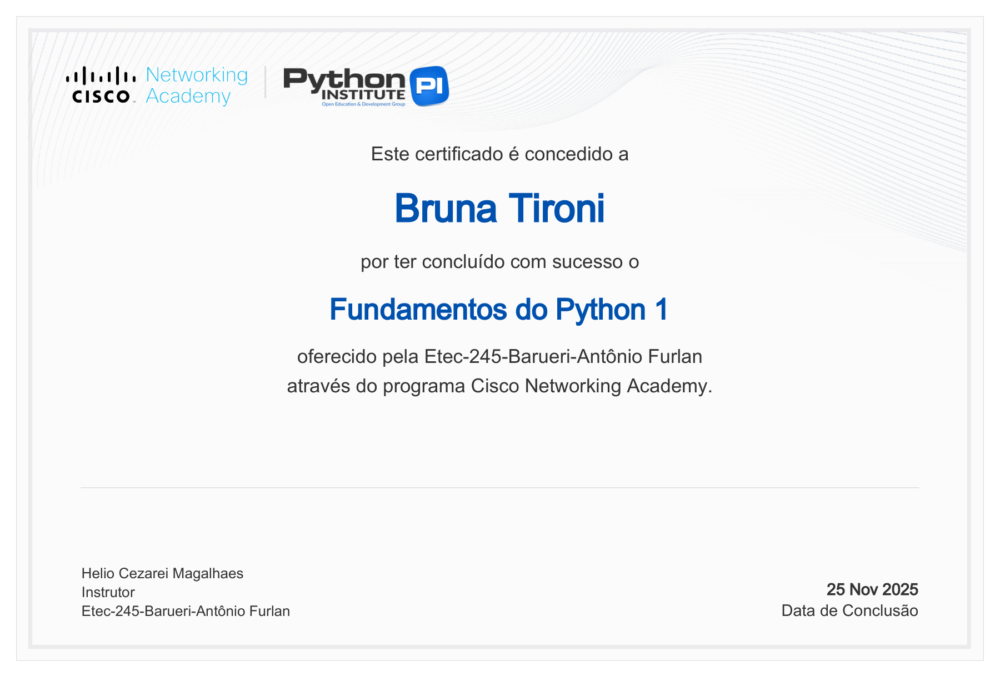
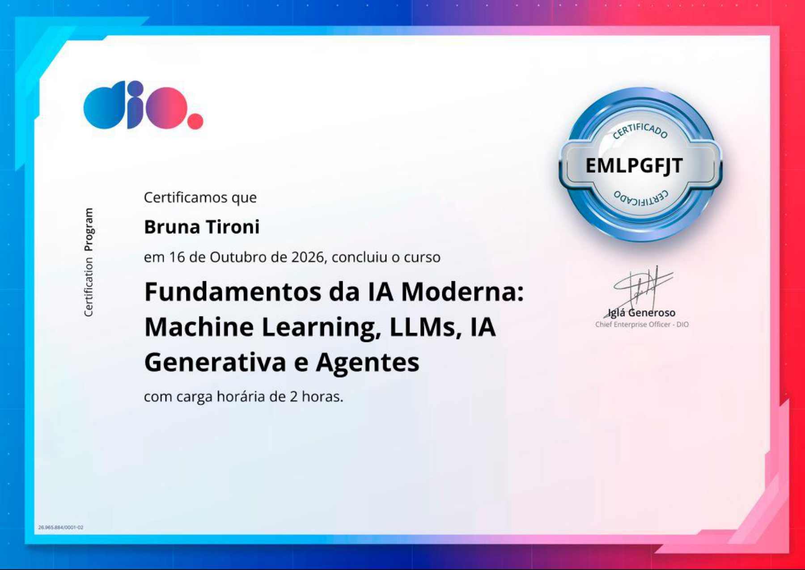
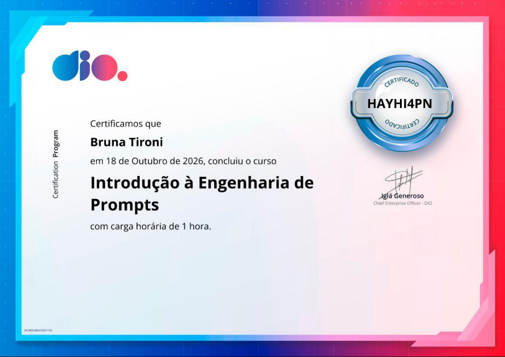
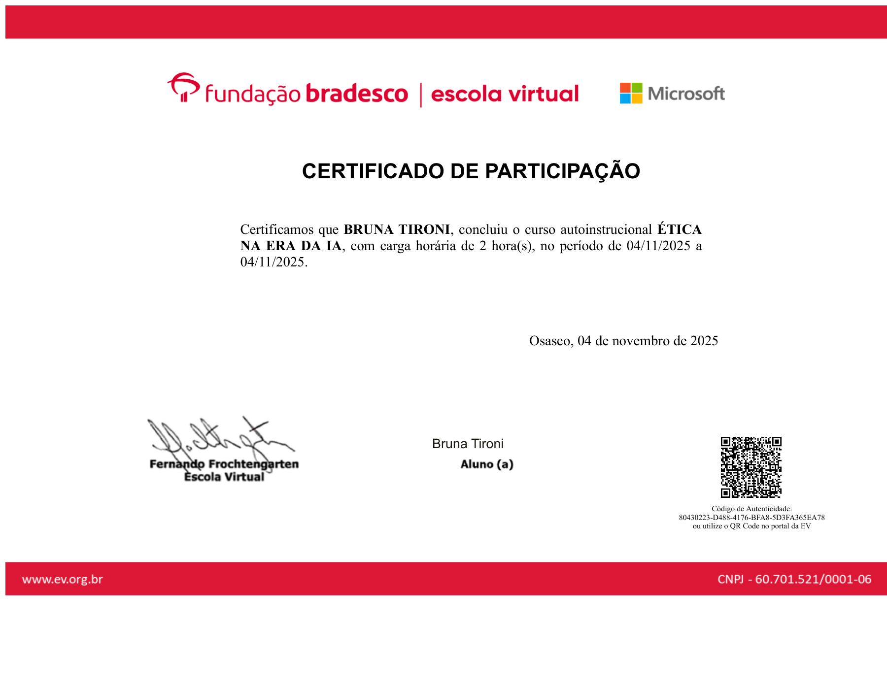
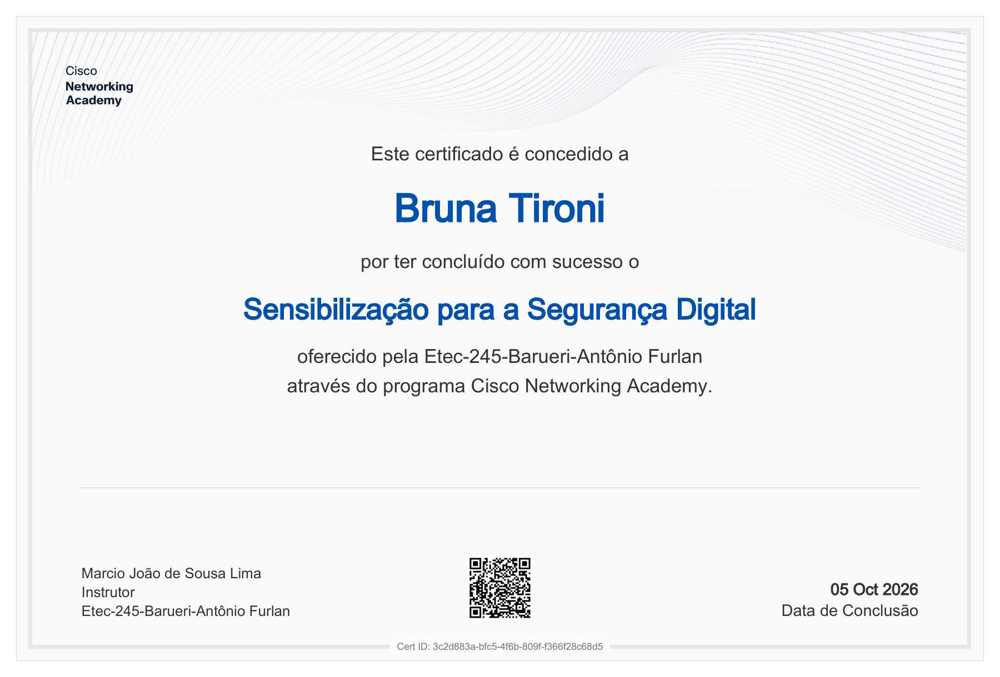
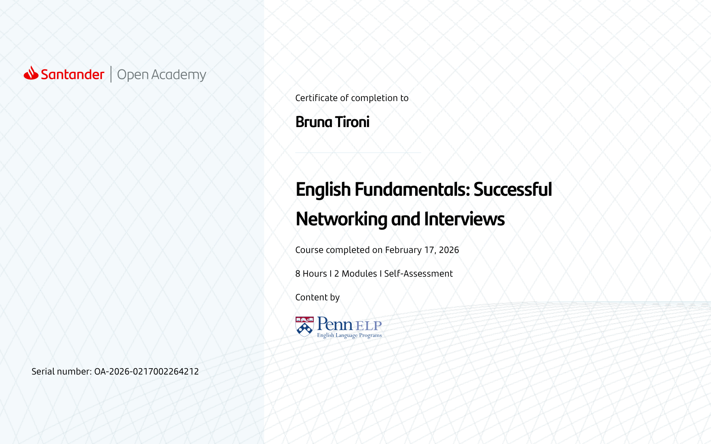
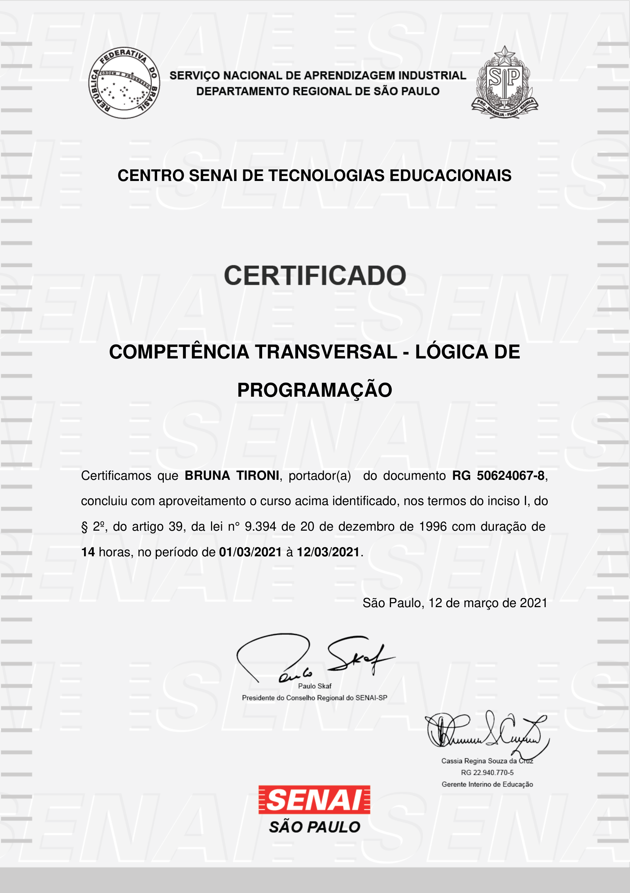

<!-- Perfil: bru-ddecor | Português BR + English -->
<!-- Paleta: creme F6F2EC · marsala 7B3548 · marinho 25344F · dourado B99A62 -->

  

  <strong>Estudante de Ciência da Computação e Desenvolvimento de Sistemas</strong> 
  Desenvolvimento web · Interesse em IA, automação e Java

  

  <a href="#sobre-mim">Sobre mim</a> ·
  <a href="#tecnologias">Tecnologias</a> ·
  <a href="#projetos-selecionados">Projetos</a> ·
  <a href="#contato">Contato</a> ·
  <a href="#english">English ↓</a>

<strong id= "sobre-mim">Sobre mim</strong> 
Estou construindo minha trajetória em desenvolvimento de software, com atenção tanto à lógica quanto à experiência de quem usa o produto. Minha sensibilidade à estética e meu interesse por UX/UI orientam a forma como penso interfaces: hierarquia visual, clareza e cuidado com os detalhes. Trago da experiência em atendimento ao cliente a escuta e a comunicação para compreender necessidades e explicar soluções. Tenho facilidade para aprender ferramentas, gosto de investigar o que ainda não entendo e transformar o aprendizado em prática. Busco minha primeira oportunidade profissional em tecnologia, em uma equipe na qual eu possa contribuir, receber orientação e assumir responsabilidades à medida que evoluo.
- Formação:  cursando Ciência da Computação na UNIP e Técnico em Desenvolvimento de Sistemas na ETEC.
- Prática atual:  interfaces web e estudos de integração com serviços e dados.
- Próximos passos:  aprofundar Java e Python, com interesse em IA e automação.
- Além do código:  amo design, culturas e idiomas.
Gosto de entender como algo funciona e de cuidar de como isso chega às pessoas.

<strong id= "tecnologias">Tecnologias utilizadas em projetos e estudos</strong> 

  

<strong>Interfaces, ferramentas e desenvolvimento de aplicativos</strong> 

  

<strong>Em aprendizado</strong> 

  

As tecnologias representam meu contato em projetos e estudos, sem equivalência de domínio entre elas.  
<strong id= "projetos-selecionados">Projetos selecionados</strong> 
Uma seleção do que já está no código. Os três projetos estão em desenvolvimento; as descrições abaixo delimitam o que foi implementado.  
<table>
  <tr>
    <td width="50%" valign="top">
      <h3>01 · Malagon</h3>
      
<strong>Planejamento de intercâmbio</strong>

      
Interface com busca de universidades e filtros por país, além de um painel de estimativas financeiras. O servidor inclui rotas para listar universidades e consultar por identificador, com dados definidos no código.

      
<code>HTML</code> <code>CSS</code> <code>JavaScript</code> <code>Node.js</code> <code>Express</code>

      
TCC em desenvolvimento · sem apresentar integrações futuras como concluídas.

      <a href="https://github.com/bru-ddecor/Malagon"><strong>Explorar o código ↗</strong></a>
    </td>
    <td width="50%" valign="top">
      <h3>02 · LumaLabVitrine</h3>
      
<strong>Identidade visual em uma interface React</strong>

      
Protótipo de vitrine com pesquisa por nome, coleções expansíveis e galerias navegáveis por produto. Os componentes incluem rótulos de acessibilidade; imagens e produtos ainda são ilustrativos.

      
<code>React</code> <code>JavaScript</code> <code>CSS</code>

      
Protótipo de interface · sem fluxo de compra implementado.

      <a href="https://github.com/bru-ddecor/LumaLabVitrine"><strong>Explorar o código ↗</strong></a>
    </td>
  </tr>
  <tr>
    <td width="50%" valign="top">
      <h3>03 · ItalyGuide</h3>
      
<strong>Exploração visual com Flutter</strong>

      
Interface de guia turístico com categorias e destinos, alternância entre temas claro e escuro e gerenciamento do tema com Provider. A tela inicial adapta a grade à largura disponível e inclui animações nos cartões.

      
<code>Flutter</code> <code>Dart</code> <code>Provider</code>

      
Projeto acadêmico · conteúdo de demonstração e navegação em evolução.

      <a href="https://github.com/bru-ddecor/ItalyGuide"><strong>Explorar o código ↗</strong></a>
    </td>
    <td width="50%" valign="top">
      <h3>O que conecta esses projetos</h3>
      
Meu interesse em transformar informação em interfaces compreensíveis, explorar diferentes ferramentas e aproximar desenvolvimento e design.

      
Este perfil acompanha uma formação em andamento. Prefiro mostrar o estágio real de cada projeto e evoluir a partir dele.

      <a href="https://github.com/bru-ddecor?tab=repositories"><strong>Ver todos os repositórios ↗</strong></a>
    </td>
  </tr>
</table>

Cursos e aprendizado contínuo
Uma coleção em construção: cursos que complementam minha formação e acompanham meus próximos passos em tecnologia.

[**Explorar a pasta de certificados ↗**](./certificados/)

<strong>Ver minha coleção de certificados</strong>

Clique em uma miniatura para abrir a imagem em tamanho maior.
<table>
  <tr>
    <td width="50%" align="center" valign="top">
      
       <strong>Fundamentos do Python 1</strong>
       Cisco Networking Academy
    </td>
    <td width="50%" align="center" valign="top">
      
       <strong>Fundamentos da IA Moderna</strong>
       DIO
    </td>
  </tr>
  <tr>
    <td width="50%" align="center" valign="top">
      
       <strong>Introdução à Engenharia de Prompts</strong>
       DIO
    </td>
    <td width="50%" align="center" valign="top">
      
       <strong>Ética na Era da IA</strong>
       Fundação Bradesco · Escola Virtual
    </td>
  </tr>
  <tr>
    <td width="50%" align="center" valign="top">
      
       <strong>Potencializando Seus Estudos e Carreira com IA</strong>
       DIO
    </td>
    <td width="50%" align="center" valign="top">
      
       <strong>DIO Agent: Nunca Mais Estude Sozinho</strong>
       DIO
    </td>
  </tr>
  <tr>
    <td width="50%" align="center" valign="top">
      
       <strong>Sensibilização para a Segurança Digital</strong>
       Cisco Networking Academy
    </td>
    <td width="50%" align="center" valign="top">
      
       <strong>English Fundamentals: Successful Networking and Interviews</strong>
       Santander Open Academy · conteúdo Penn ELP
    </td>
  </tr>
  <tr>
    <td width="50%" align="center" valign="top">
      
       <strong>Lógica de Programação</strong>
       SENAI
    </td>
    <td width="50%" align="center" valign="top">
      
       <strong>Excel Básico</strong>
       SENAI
    </td>
  </tr>
</table>

Atividade no GitHub

<strong>Ver estatísticas, linguagens, sequência de contribuições e troféus</strong>

  
  

  

  

  

Os painéis dependem de serviços externos e podem ficar indisponíveis. A distribuição de linguagens reflete o código analisado pelo serviço, não o nível de proficiência.

Contribuições em movimento

  <picture>
    <source media="(prefers-color-scheme: dark)" srcset="https://raw.githubusercontent.com/bru-ddecor/bru-ddecor/output/github-snake-dark.svg" />
    <source media="(prefers-color-scheme: light)" srcset="https://raw.githubusercontent.com/bru-ddecor/bru-ddecor/output/github-snake.svg" />
    
  </picture>

<!-- A animação aparece após a primeira execução bem-sucedida de .github/workflows/snake.yml. -->

<h2 id= "contato">Contato</h2>
Aberta a oportunidades de estágio e de entrada em desenvolvimento de software.

 
  
  
  

 

<h1 id= "english"><strong>English</strong></h1> 
<strong>Computer Science & Systems Development Student</strong> 
Web development · Interested in AI, automation and Java  

I am building my career in software development, paying attention to both application logic and the experience of the people using it. My eye for aesthetics and interest in UX/UI shape how I approach interfaces: clear visual hierarchy, usability and thoughtful details. My customer service background has strengthened my listening and communication skills, helping me understand needs and explain solutions. I pick up new tools quickly, enjoy investigating unfamiliar concepts and learn through hands-on work. I am looking for my first professional opportunity in technology, where I can contribute, learn from an experienced team and take on more responsibility as I grow.  
- Education: Computer Science at UNIP and a Technical Program in Systems Development at ETEC.
- Current practice: web interfaces and learning how to integrate services and data.
- Learning next: Java and Python, with an interest in AI and automation.
- Beyond code: design, cultures, languages and automotive aesthetics.  
<strong>Courses & continuous learning</strong> 
An expanding collection of completed courses supporting my education in programming, AI and digital skills.

[**Browse my certificates↗**](./certificados/)  

<strong>View my collection of certificates</strong>

Click on a thumbnail to open the image in a larger size.
<table>
  <tr>
    <td width="50%" align="center" valign="top">
      
       <strong>Python Fundamentals 1</strong>
       Cisco Networking Academy
    </td>
    <td width="50%" align="center" valign="top">
      
       <strong>Fundamentals of Modern AI</strong>
       DIO
    </td>
  </tr>
  <tr>
    <td width="50%" align="center" valign="top">
      
       <strong>Introduction to Prompt Engineering</strong>
       DIO
    </td>
    <td width="50%" align="center" valign="top">
      
       <strong>Ethics in the Age of AI</strong>
       Fundação Bradesco · Escola Virtual/ Virtual school
    </td>
  </tr>
  <tr>
    <td width="50%" align="center" valign="top">
      
       <strong>Boosting Your Studies and Career with AI</strong>
       DIO
    </td>
    <td width="50%" align="center" valign="top">
      
       <strong>DIO Agent: Never Study Alone Again</strong>
       DIO
    </td>
  </tr>
  <tr>
    <td width="50%" align="center" valign="top">
      
       <strong>Raising Awareness for Digital Sec</strong>
       Cisco Networking Academy
    </td>
    <td width="50%" align="center" valign="top">
      
       <strong>English Fundamentals: Successful Networking and Interviews</strong>
       Santander Open Academy · conteúdo Penn ELP
    </td>
  </tr>
  <tr>
    <td width="50%" align="center" valign="top">
      
       <strong>Programming Logic</strong>
       SENAI
    </td>
    <td width="50%" align="center" valign="top">
      
       <strong>Basic Excel</strong>
       SENAI
    </td>
  </tr>
</table>

<a href="#projetos-selecionados">**Selected projects**</a> 
All three projects are under development. These descriptions cover existing code rather than planned features.

**Malagon**  University search interface with country filters, a financial estimation dashboard and server routes that return university data defined in code.	 HTML, CSS, JavaScript, Node.js, Express 
**LumaLabVitrine**	 Storefront prototype with name search, expandable collections and product galleries. Product information and images are illustrative; no purchase flow is implemented.	 React, JavaScript, CSS 
**ItalyGuide**	 Tourism guide interface with categories, destination cards, light/dark themes managed with Provider and an adaptive grid.	 Flutter, Dart, Provider 

Open to internships and entry-level software development opportunities.

 
  
  
  

 

  <strong>Bruna Tironi</strong> 
  Clareza na interface. Cuidado nos detalhes. Curiosidade para continuar. 
  Clear interfaces. Thoughtful details. Curiosity to keep learning.

